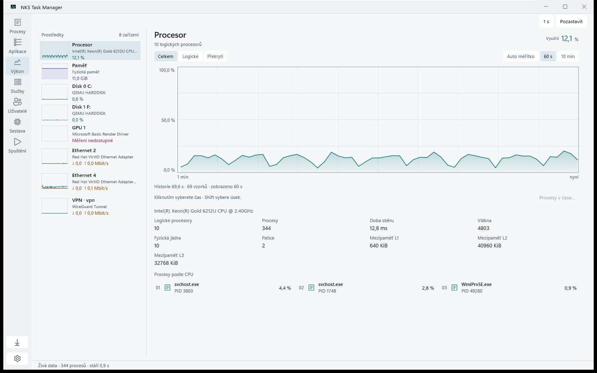
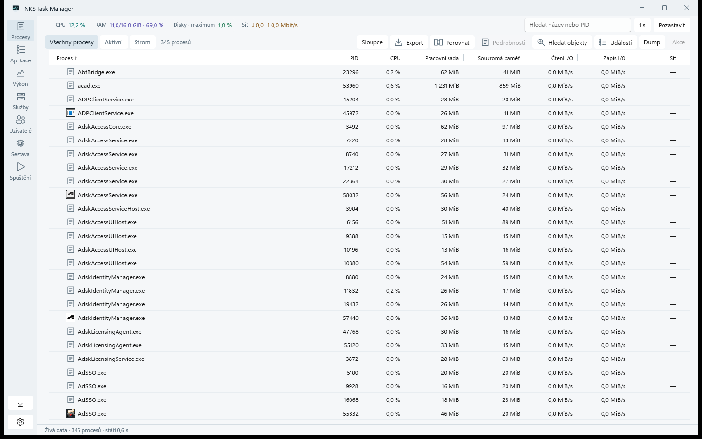
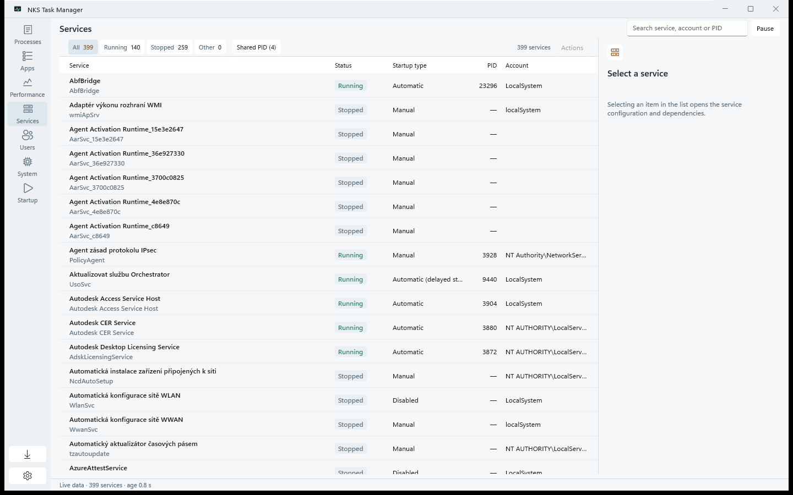
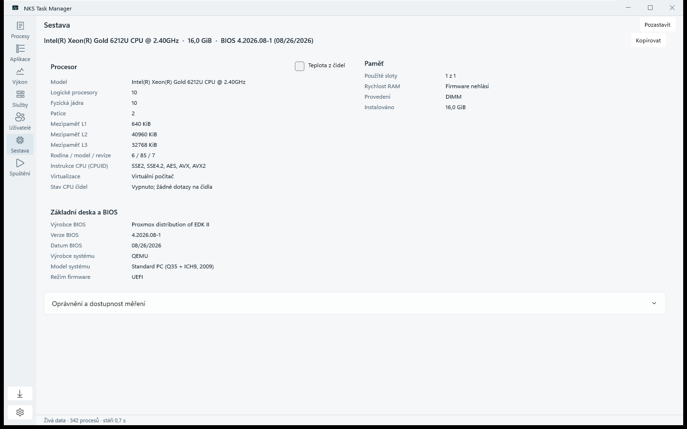
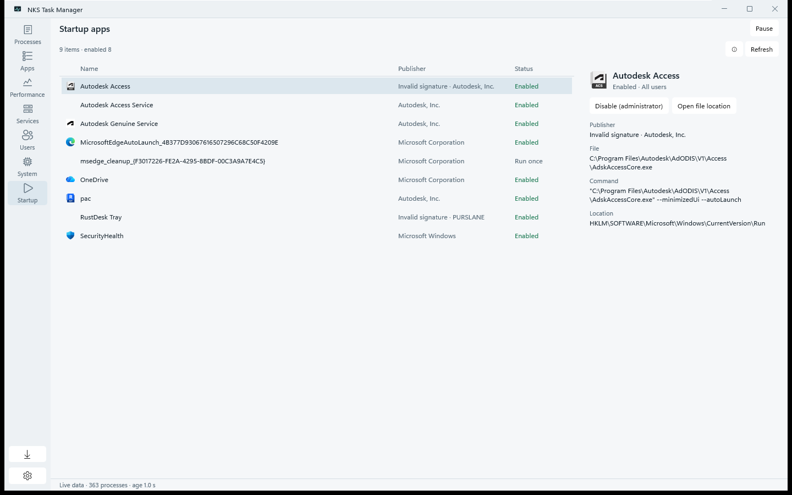

# NKS Task Manager

[](https://github.com/nks-hub/nks-taskmgr/actions/workflows/ci.yml)
[](https://github.com/nks-hub/nks-taskmgr/releases)


A Windows process and system monitor with a C#/WinUI 3 Native AOT interface and a C++20 core. The interface is available in Czech, English, German, Slovak and Polish.



## Features

- 🔎 **Processes** - Table, tree and application groups with search, sorting, column layout, branch totals and process details (threads, modules, memory map, handles, signatures).
- 📊 **Performance** - CPU per logical processor, memory, pagefile, disks with SMART/NVMe health, GPU engines and memory, network adapters with totals since start.
- 🛠️ **Services** - State filters, accounts, dependencies, shared host processes, start/stop/restart with a dependency plan.
- 👥 **Users** - Logged-on sessions with resource totals, disconnect, log off and send message.
- 🚀 **Startup** - Run keys and Startup folders with publisher signatures; enable or disable current-user items the way Windows does.
- 🧰 **Process actions** - Close, end, end tree, suspend, resume, priority, affinity, CPU Sets and dumps (x64 and WOW64), each checked against the process lifetime before acting.
- ⏱️ **History** - Shared graph cursor, time ranges and the processes recorded at a chosen moment.
- 📄 **Snapshots** - JSON export without names by default, and comparison of two snapshots.
- 🕒 **ETW events** - Process start/stop and disk/network attribution when run as administrator.
- 🔁 **Task Manager replacement** - Optional IFEO registration for a machine-wide install, with restore of the previous value.
- 🌐 **Languages** - Czech, English, German, Slovak and Polish, chosen from the Windows display language or set manually.
- 📦 **Updates** - Checks GitHub Releases, downloads the signed setup and installs it in the same mode, including Program Files installs through UAC.

Helpers run as separate processes with the user's own rights. Missing data is shown as unavailable, never as zero.

## Requirements

- Windows 10 or 11, x64. No administrator rights needed for normal use.
- To build: Visual Studio 2022 with C++ desktop tools (MSVC 14.44, x64 and x86), Windows SDK 10.0.26100.0, CMake 3.31+, PowerShell 7.2+, .NET SDK 10.0.403.
- To package: Inno Setup 7.1.1.

## Installation

Download the setup or the portable ZIP from [Releases](https://github.com/nks-hub/nks-taskmgr/releases). The installer runs without administrator rights. Releases from 0.2.8 are signed with a self-signed NKS Hub certificate, so SmartScreen still asks on first start. In-app updates verify that signature against the key built into the application and need the certificate trusted on the machine; as administrator run `Import-Certificate docs\nks-hub-codesign.cer -CertStoreLocation Cert:\LocalMachine\Root` and the same for `Cert:\LocalMachine\TrustedPublisher`.

Build from source:

```powershell
pwsh -NoProfile -File scripts/build.ps1 -Configuration Release -WinUI -Test
./build/winui-aot/NksTaskMgr.WinUI.exe
```

Build the installer and portable ZIP into `build/packages`:

```powershell
pwsh -NoProfile -File scripts/package.ps1 -Compiler ISCC.exe
```

Optional build parameters:

- `-SentryDsn` enables crash reports through Sentry; without it the SDK is not included.
- `-SigningCertificateThumbprint` and `-SignTool` sign the NKS binaries and setup and pin the broker and updater to that publisher key.

See [docs/building.md](docs/building.md) for all build, packaging and signing options.

## Screenshots

| Processes | Services |
| --- | --- |
|  |  |
| **System** | **Startup** |
|  |  |

Captured on a Windows 11 virtual machine under a standard account with the interface set to English. Service and device names come from Windows itself, which is Czech on that machine.

## Usage

- Left navigation switches views; `--view=processes|performance|services|users|startup|hardware|applications` opens one directly.
- Ctrl+F searches by name or PID. Ctrl/Shift selects several rows; the context menu holds process actions.
- In graphs, click pins a time, Shift-click selects a range and Escape returns to live data.
- CPU temperature can be read from a running LibreHardwareMonitor-compatible API on `127.0.0.1:8085` (off by default).
- Appearance follows Windows or can be set to light or dark.
- The language follows the Windows display language; Appearance → Language overrides it after a restart.

The application sends nothing over the network except the optional sensor read and, in builds with `-SentryDsn`, crash reports. [docs/architecture.md](docs/architecture.md) describes each view, helper process and the native API.

## Testing

```powershell
pwsh -NoProfile -File scripts/build.ps1 -Configuration Release -Test
pwsh -NoProfile -File scripts/build.ps1 -Configuration Release -Benchmark
./build/winui-aot/NksTaskMgr.WinUI.exe --smoke=$env:TEMP\nks-smoke.txt
```

`-Test` runs the native test suite, `--smoke` runs the in-app UI checks and exits with code 0 on success. `benchmarks/desktop_bench.ps1` measures CPU, memory and handles of a running instance. [docs/testing.md](docs/testing.md) lists every test and benchmark; acceptance status is tracked in [TODO.md](TODO.md).

Process enumeration and NT declarations come from [System Informer](https://github.com/winsiderss/systeminformer/tree/99a0d28e091878967a804ac9ea2fe22f2c1fdadb); the license is in `third_party/phnt/LICENSE`.

## Contributing

1. Fork the repository.
2. Create a branch for the change.
3. Commit the change with a message such as `feat: add a process filter`.
4. Push the branch to your fork.
5. Open a pull request with the behavior change and verification results.

## Support

- 📧 **Email:** dev@nks-hub.cz
- 🐛 **Bug reports:** [GitHub Issues](https://github.com/nks-hub/nks-taskmgr/issues)

## License

MIT License — see [LICENSE](LICENSE) for details.

---

<p align="center">Made with ❤️ by <a href="https://github.com/nks-hub">NKS Hub</a></p>
